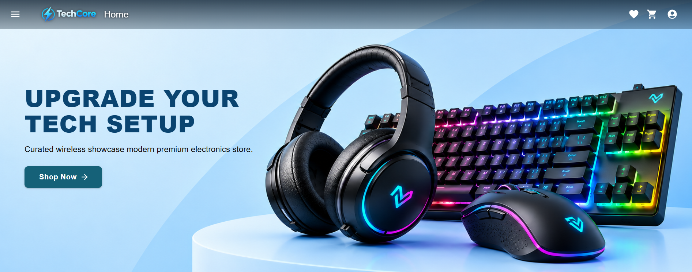

# React E-commerce Store

A modern storefront built with React, TypeScript, Vite, and Material UI. This project includes a home page with featured products, category browsing, product details, cart management, checkout flow, and order tracking.

## Website

**Live:** [Click Here](https://tech-core-react.vercel.app/)




## Features

- Responsive home page with hero banner, product collections, and category browsing
- Product cards and individual product detail pages
- Wishlist actions from product cards and product details
- Shopping cart with quantity updates, item removal, and subtotal calculation
- Checkout summary with shipping calculation and the `DISCOUNT10` promo code
- Demo order placement and order history with search and status filters
- Snackbar feedback for shopping actions
- Material UI components and responsive layouts

## Tech Stack

- React 19
- TypeScript
- Vite
- React Router
- Material UI
- Stripe-ready dependencies for checkout integration
- Auth0-ready dependencies for authentication

## Project Structure

```text
public/
  images/
src/
  App.tsx
  main.tsx
  index.css
  components/
    CategoryCollections.tsx
    HeroBanner.tsx
    OrderSuccessDialog.tsx
    ProductCard.tsx
    interface.ts
    checkout/
      CartItemCard.tsx
      CheckoutHeader.tsx
      EmptyCart.tsx
      OrderSummary.tsx
      TrustBadges.tsx
      index.ts
      interfaces/
        interface.ts
    layout/
      Navbar.tsx
    product-details/
      ProductActions.tsx
      ProductImageSection.tsx
      ProductInfo.tsx
      ProductNotFound.tsx
      ProductTrustBadges.tsx
      index.ts
      interfaces/
        interface.ts
  context/
    AuthContext.tsx
    CartContext.tsx
    SnackbarContext.tsx
    WishListContext.tsx
    interfaces/
      interface.tsx
  data/
    categories.tsx
    products.ts
  interfaces/
    checkout.interface.ts
    orders.interface.ts
    productDetails.interface.ts
  pages/
    Checkout.tsx
    Home.tsx
    NotFound.tsx
    index.tsx
    Orders.tsx
    ProductDetails.tsx
```

## Getting Started

### Prerequisites

- Node.js 18+
- npm or yarn

### Installation

```bash
npm install
```

### Run the app locally

```bash
npm run dev
```

The app will start in development mode and usually be available at:

```text
http://localhost:5173
```

### Build for production

```bash
npm run build
```

### Preview production build

```bash
npm run preview
```

## Available Scripts

```bash
npm run dev      # Start the Vite dev server
npm run build    # Type-check and create a production build
npm run preview  # Preview the production build locally
npm run lint     # Run ESLint checks
```

## Data and Payments

Products are local demo data. Cart, wishlist, and order state are held in React memory, so they reset when the page reloads. Checkout creates a demo order only; it does not charge a payment method. Add a backend for durable, user-specific data and connect Stripe through a server-side payment flow before accepting real payments.

## License

This project is for learning and demo purposes.
